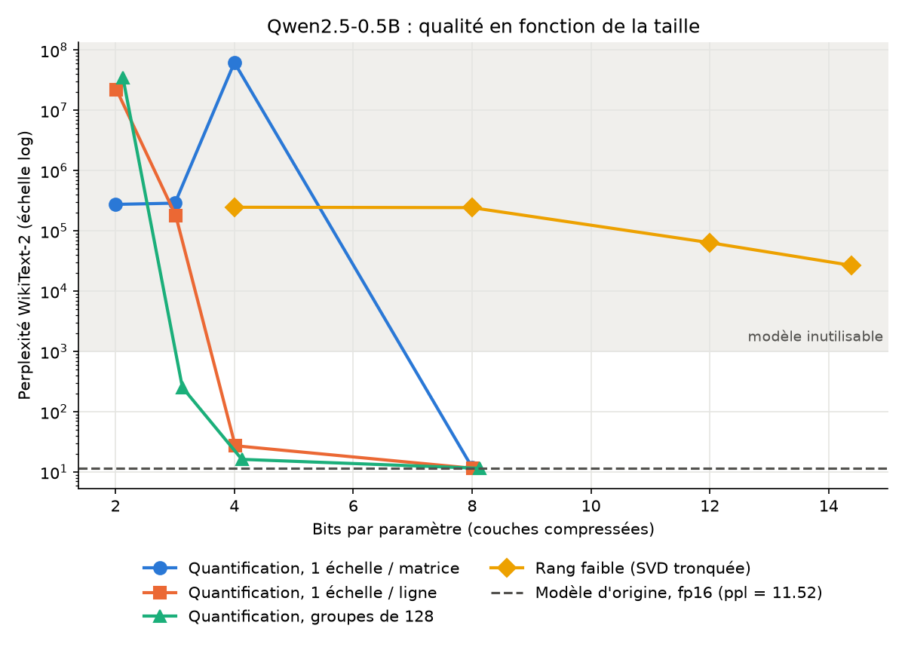
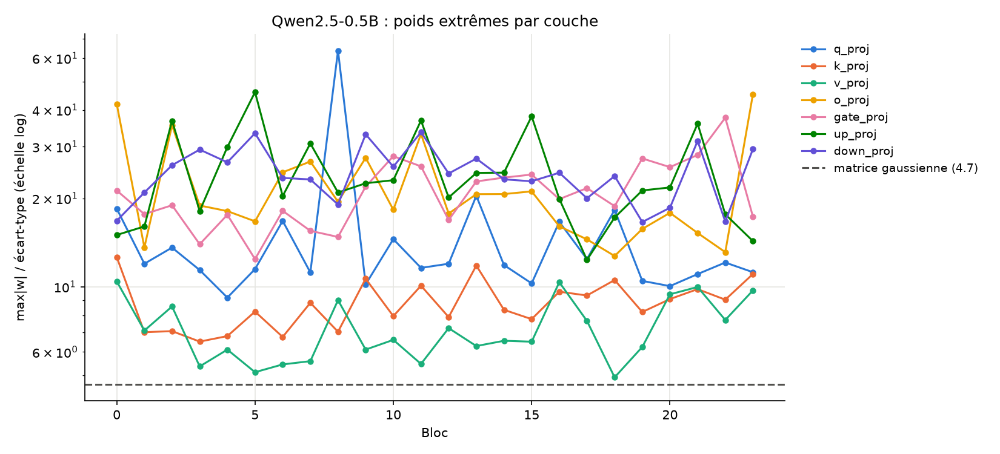
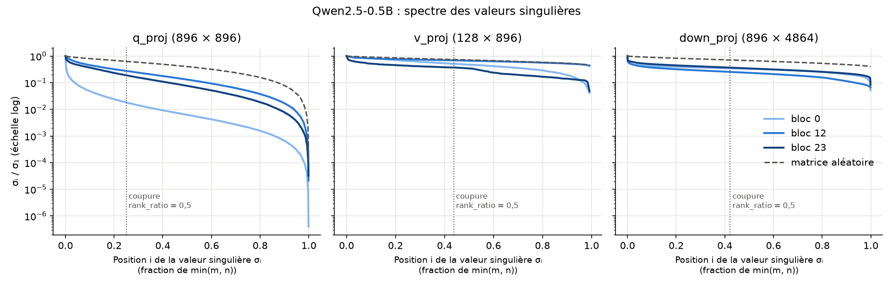

# Compresser un petit LLM : quantification ou rang faible ?

> **In English.** How much quality does a small LLM (Qwen2.5-0.5B) lose when its weights are compressed? I implemented two methods from scratch, symmetric quantization (8 to 2 bits, per tensor / row / group of 128) and truncated-SVD low-rank approximation, and measured WikiText-2 perplexity. Quantization with groups of 128 is nearly lossless at 8 bits and remains usable at 4 bits (perplexity 16.2 vs 11.5); one scale per matrix fails because LLM weights contain extreme outliers (up to 64 standard deviations). Low-rank approximation breaks the model at every budget tested, even at 14.4 bits per weight (perplexity above 26,000): the singular value spectra of most layers are almost as flat as those of a random matrix, so every direction carries information.

## La question

Un LLM stocke ses poids en 16 bits. Pour le faire tenir sur une machine plus modeste, on peut :

- **quantifier** : garder tous les poids, mais chacun sur moins de bits (8, 4, 3 ou 2) ;
- **approximer par une matrice de rang faible** : garder des poids en 16 bits, mais beaucoup moins nombreux.

**À taille égale, quelle méthode abîme le moins le modèle, et pourquoi ?**

## Méthode

| Élément | Choix |
| --- | --- |
| Modèle | [Qwen2.5-0.5B](https://huggingface.co/Qwen/Qwen2.5-0.5B) en fp16 (494 M de paramètres, 24 blocs) |
| Couches compressées | les 7 matrices de chaque bloc (`q`, `k`, `v`, `o`, `gate`, `up`, `down`), soit 168 matrices ; embeddings non touchés |
| Qualité | perplexité sur WikiText-2 (partie test, 299 078 tokens), fenêtre glissante de 2 048 tokens avec un pas de 512 |
| Taille | bits par paramètre des couches compressées, échelles de quantification comprises |

**Quantification symétrique** ([src/quant.py](src/quant.py)). Chaque poids est remplacé par le point le plus proche d'une grille de 2^b valeurs :

$$q_{\max} = 2^{b-1} - 1, \qquad s = \frac{\max |w_{\text{groupe}}|}{q_{\max}}, \qquad \hat{w} = s \cdot \mathrm{clamp}\left(\mathrm{round}(w / s),\, -q_{\max} - 1,\, q_{\max}\right)$$

L'échelle s est calculée pour toute la matrice (`tensor`), pour chaque ligne (`row`) ou pour chaque groupe de 128 poids consécutifs (`128`). Chaque échelle coûte 16 bits : b + 16/128 bits par poids pour des groupes de 128.

**Rang faible** ([src/lowrank.py](src/lowrank.py)). Chaque matrice W (m × n) est remplacée par sa SVD tronquée aux r plus grandes valeurs singulières, qui coûte r(m + n) paramètres au lieu de mn. Le rang est choisi pour garder une fraction `rank_ratio` des paramètres : r = ⌊rank_ratio · mn / (m + n)⌋.

La compression est **simulée** : les poids compressés sont reconvertis en fp16 pour l'évaluation, et la taille gagnée est calculée à part ([src/budget.py](src/budget.py)).

## Résultats

### Perplexité des deux méthodes



**Quantification**, perplexité WikiText-2 (modèle d'origine : **11,52**) :

| Bits | 1 échelle / matrice | 1 échelle / ligne | Groupes de 128 |
| --- | --- | --- | --- |
| 8 | 11,96 | 11,54 | **11,53** |
| 4 | 6,2 × 10⁷ | 27,3 | **16,2** |
| 3 | 2,9 × 10⁵ | 1,8 × 10⁵ | **253** |
| 2 | 2,8 × 10⁵ | 2,2 × 10⁷ | 3,5 × 10⁷ |

**Rang faible** :

| `rank_ratio` | Bits par poids | Perplexité |
| --- | --- | --- |
| 0,9 | 14,4 | 2,7 × 10⁴ |
| 0,75 | 12,0 | 6,4 × 10⁴ |
| 0,5 | 8,0 | 2,4 × 10⁵ |
| 0,25 | 4,0 | 2,5 × 10⁵ |

Au-delà d'une perplexité d'environ 1 000, le modèle ne produit plus que du bruit et les écarts entre configurations n'ont plus de sens.

Vérification : au rang plein, la SVD retrouve exactement la perplexité de référence. Sur un extrait de 2 048 tokens, même `rank_ratio` = 1, qui ne fait gagner aucune place, fait passer la perplexité de 9,4 à plus de 15 000.

### Poids extrêmes



Pour chaque matrice, le rapport entre le plus grand poids (en valeur absolue) et l'écart-type des poids. Une matrice gaussienne de même taille donne 4,7. Dans Qwen, les couches MLP et `o_proj` sont entre 15 et 45, avec un maximum de 64 (bloc 8, `q_proj`) ; `k_proj` et `v_proj` restent entre 5 et 12.

### Spectre des valeurs singulières



Valeurs singulières σᵢ / σ₁, triées, pour trois types de couches au début, au milieu et à la fin du modèle, comparées à une matrice aléatoire de même forme. Part de l'énergie (Σσ²) conservée par la SVD tronquée avec `rank_ratio` = 0,5 :

| Couche | Bloc 0 | Bloc 12 | Bloc 23 | Matrice aléatoire |
| --- | --- | --- | --- | --- |
| `q_proj` | 99 % | 83 % | 89 % | 62 % |
| `v_proj` | 76 % | 57 % | 78 % | 59 % |
| `down_proj` | 61 % | 72 % | 66 % | 60 % |

### Échauffement : un MLP sur MNIST

Avant le LLM, les deux fonctions ont été testées sur un petit réseau (784 → 256 → 256 → 10, précision de référence 97,6 %), à taille égale. Garder une fraction `rank_ratio` des poids en 16 bits coûte environ 16 × `rank_ratio` bits par poids : `rank_ratio` = 0,5 correspond donc à 8 bits, et 0,25 à 4 bits.

| Bits par poids | Quantification (groupes de 16) | Rang faible |
| --- | --- | --- |
| 8 | 97,6 % | 75,4 % (`rank_ratio` = 0,5) |
| 4 | 97,5 % | 32,5 % (`rank_ratio` = 0,25) |

## Ce qu'on observe et pourquoi

**En bref : la quantification par petits groupes est la méthode robuste ; le rang faible détruit le modèle à tous les budgets testés, car l'information des poids est répartie sur presque toutes les directions.**

**Quantification.** Le modèle ne perd presque rien en 8 bits (11,53 contre 11,52). En 4 bits, tout dépend de la granularité : 16,2 avec des groupes de 128, alors qu'une seule échelle par matrice détruit le modèle. La cause : des poids extrêmes, jusqu'à 64 écarts-types dans Qwen, qui élargissent les crans de tout leur groupe. Des groupes plus petits limitent les poids pénalisés. En 3 bits, même les groupes de 128 ne suffisent plus.

**Rang faible.** Même à 14,4 bits par poids, la perplexité dépasse 26 000, alors que la quantification en 4 bits reste à 16,2. Les spectres de `down_proj` et `v_proj` expliquent cet échec : ils sont presque aussi plats que celui d'une matrice aléatoire, donc toutes les directions portent une information comparable, et en supprimer coûte cher, surtout dans le MLP, qui représente environ 88 % des poids. `q_proj`, nettement de rang faible, fait exception. Sur MNIST, le rang faible perdait déjà plus que la quantification, mais restait utilisable ; un LLM y est bien plus sensible.

**Deux erreurs de nature différente.** La quantification ajoute un petit bruit à tous les poids, que le modèle tolère tant qu'il reste assez de bits ; le rang faible supprime des directions entières.

## Limites

- **Compression simulée** : les poids sont reconvertis en fp16 ; on mesure la qualité, pas le gain réel en mémoire ni en vitesse.
- **Une seule mesure de qualité** : la perplexité sur WikiText-2, pas les performances sur des tâches.
- **Un seul modèle**, de petite taille : les conclusions peuvent différer sur des modèles plus gros.
- **Méthodes de base** : arrondi au plus proche, sans calibration sur des données ni correction d'erreur.
- **Perplexité non directement comparable aux articles** : la fenêtre glissante donne plus de contexte à chaque token qu'une évaluation par fenêtres disjointes, donc une perplexité plus basse.

## Pour aller plus loin

- Récupérer la qualité perdue en 3 bits en entraînant des adaptateurs LoRA sur le modèle quantifié.
- Combiner les deux méthodes : quantifier, puis corriger l'erreur avec un terme de rang faible.
- Évaluer quelques configurations sur des tâches de raisonnement plutôt que sur la seule perplexité.

## Reproduire

```bash
pip install -r requirements.txt
pytest                                   # tests des deux fonctions de compression
python -m scripts.mnist_warmup           # échauffement MNIST (CPU, ~1 min)
python -m scripts.analyze_weights        # poids extrêmes et spectre (CPU, ~1 min)
python -m scripts.run_quant              # grille de quantification (GPU, ~1 h sur T4)
python -m scripts.run_lowrank            # grille de rang faible (GPU, ~20 min sur T4)
python -m scripts.plot                   # courbe à partir de results/*.csv
```

Sur Google Colab (GPU T4 gratuit) : [notebooks/colab.ipynb](notebooks/colab.ipynb). Les résultats sont écrits sur Google Drive au fur et à mesure, et une expérience déjà présente dans le CSV n'est pas relancée.

## Structure

```
src/
  quant.py          quantize() : quantification symétrique
  lowrank.py        lowrank_approx() : SVD tronquée
  apply.py          applique une fonction de compression aux 168 matrices
  eval_ppl.py       chargement du modèle et perplexité WikiText-2
  budget.py         bits par paramètre de chaque configuration
  results.py        lecture et écriture des CSV
scripts/            expériences, analyse des poids, graphiques
tests/              tests unitaires des deux fonctions
results/            un CSV par grille, une ligne par expérience
figures/            graphiques
```
